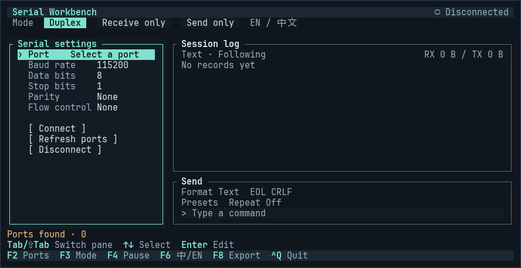

<h1 align="center">
  
</h1>

<p align="center">
  <strong>A keyboard-only serial workbench for Linux terminals</strong><br>
  Configure a port, send text or HEX, and inspect the reply on the same screen.
</p>

<p align="center">
  <kbd>Linux</kbd> &nbsp; <kbd>Rust 1.88+</kbd> &nbsp; <kbd>English / 中文</kbd> &nbsp; <a href="LICENSE"><kbd>MIT</kbd></a>
</p>

<p align="center">
  <a href="#quick-start">Quick start</a> · <a href="#connect-a-device">Connect a device</a> · <a href="#keyboard-reference">Keys</a> · <a href="README.zh-CN.md">简体中文</a>
</p>

## Terminal



## Quick start

With Rust 1.88 or newer on Linux, run this from the project directory.

```sh
cargo run --release --locked -- --lang en
```

Plug the adapter into the Linux machine, then press `Enter` in the port field to select a device. Set the parameters to match the device and select **Connect**. The send input is ready for your command once the connection opens.

## Connect a device

```sh
cargo build --release --locked
./target/release/serial-tui --port /dev/ttyUSB0 --baud 115200
```

1. Press `F2` to focus serial settings. Use the arrow keys and `Enter` to set the port, baud rate, data bits, stop bits, parity, and flow control.
2. Select **Connect** to open the device. Use **Apply / Reconnect** after changing an open port's settings. If the device is missing from the list, choose **Enter device path…**.
3. Press `F3` to pick a work mode. In a mode that can send, use `Tab` to reach the send input and `Enter` to transmit.

Run the app on the Linux machine the adapter is plugged into. If access is denied, check the device node with `ls -l /dev/ttyUSB0` and use an account that can open it. Use an 80×24 terminal or larger for more room to read the log.

| Mode | Behavior |
| --- | --- |
| **Duplex** | Send commands and inspect replies in one timeline. |
| **Receive only** | View incoming data. The send pane closes and repeat sending stops. |
| **Send only** | Send commands or repeat a frame. Incoming bytes are discarded. |

## Keyboard reference

| Key | Action |
| --- | --- |
| `F2` / `F3` | Focus serial settings / cycle work modes |
| `F4` / `F6` | Pause or resume log following / switch English and Chinese |
| `F8` | Export retained records to a new file, with RX and TX bytes in HEX |
| `Tab` / `Shift+Tab` | Move between settings, log, send options, and send input |
| `PgUp` / `PgDn` · `←` / `→` · `End` | Page through the log, pan across long lines, or return to the latest entry |
| `H` in the log | Cycle Text, HEX, and HEX + ASCII |
| `←` / `→` and `Enter` in send options | Set text or HEX input, line endings, presets, or repeat interval |
| `↑` / `↓` · `Enter` · `Ctrl+U` in send input | Recall history, send, or clear the input |
| `Esc` / `Ctrl+Q` | Dismiss the current dialog / quit |

Pausing freezes the view while the app continues to receive. The log keeps the latest 2,000 records in memory. Press `Enter` on the active repeat option to stop repeating.

## License

[MIT](LICENSE)
