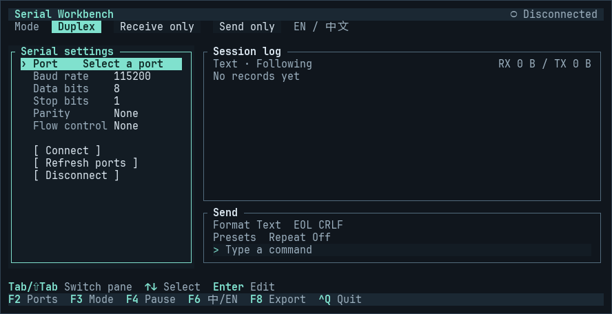

<h1 align="center">
  
</h1>

<p align="center">
  <strong>A keyboard-only serial workbench for Linux terminals</strong><br>
  Configure a port, send text or HEX, and inspect the reply on the same screen.
</p>

<p align="center">
  <kbd>🐧 Linux · x86_64 / ARM64 / ARMv7</kbd> &nbsp; <kbd>⌨️ Keyboard only</kbd> &nbsp; <kbd>🌐 English / 中文</kbd> &nbsp; <a href="LICENSE"><kbd>MIT</kbd></a>
</p>

<p align="center">
  <a href="#quick-start">⬇️ Quick start</a> · <a href="#connect-a-device">🔌 Connect a device</a> · <a href="#keyboard-reference">⌨️ Keys</a> · <a href="README.zh-CN.md">简体中文</a>
</p>

## Terminal walkthrough



Recorded from the Linux release binary. The walkthrough covers serial settings and mode switching before a device is connected.

## Quick start

Run `uname -m` on the Linux machine and choose the matching executable.

| `uname -m` | Download |
| --- | --- |
| `x86_64` | [Linux x86_64](https://github.com/Boscodoggggg/serial-tui/releases/latest/download/serial-tui-linux-x86_64) |
| `aarch64` | [Linux ARM64](https://github.com/Boscodoggggg/serial-tui/releases/latest/download/serial-tui-linux-aarch64) |
| `armv7l` or `armv8l` | [Linux ARMv7 (32-bit, hard float)](https://github.com/Boscodoggggg/serial-tui/releases/latest/download/serial-tui-linux-armv7) |

On an ARM64 board, download and run it as follows. For other architectures, use the matching download URL from the table.

```sh
curl -fL https://github.com/Boscodoggggg/serial-tui/releases/latest/download/serial-tui-linux-aarch64 -o serial-tui
chmod +x ./serial-tui
./serial-tui --lang en
```

Use `F6` to switch the interface language and `Ctrl+Q` to exit.

## Connect a device

```sh
./serial-tui --port /dev/ttyUSB0 --baud 115200 --lang en
```

1. Plug in the adapter and replace the device path and baud rate above with the values for your device. Press `F2` and use the arrow keys and `Enter` to adjust the port, baud rate, data bits, stop bits, parity, and flow control.
2. After you confirm a port in the picker, the settings highlight moves to **Connect** or **Apply / Reconnect**. Press `Enter` to open the port, or move up to adjust its settings first. If the device is missing from the list, choose **Enter device path…**.
3. Press `F3` to pick a work mode. In a mode that can send, use `Tab` to reach the send input and `Enter` to transmit.

On the first successful connection, focus moves to the log in Duplex and Receive only modes, or to the send input in Send only mode. Reconnecting or moving focus while the connection opens keeps your current focus.

Run the app on the Linux machine the adapter is plugged into. If access is denied, check the device node with `ls -l /dev/ttyUSB0` and use an account that can open it. Use an 80×24 terminal or larger for more room to read the log.

**Refresh ports** lists USB adapters and onboard UARTs using Linux device information. Each device appears once, preferring a stable `by-id` or `by-path` link when one exists. In the port picker, use `PgUp` / `PgDn` to page through the list and `F5` to refresh it in place. The selected device stays highlighted if it is still present. Choose **Connect** to check that the device can be opened.

The app remembers the last successful connection in `$XDG_STATE_HOME/serial-tui/last-connection.json` (default: `~/.local/state/serial-tui/last-connection.json`). `--port` and `--baud` override the saved values for that launch. Select **Connect** to open the device. If applying new settings fails, the app keeps the previous connection or attempts to reopen it with its previous settings.

| Mode | Behavior |
| --- | --- |
| **Duplex** | Send commands and inspect replies in one timeline. |
| **Receive only** | View incoming data. The send pane closes and repeat sending stops. |
| **Send only** | Send commands or repeat a frame. Incoming bytes are discarded. |

## Keyboard reference

| Key | Action |
| --- | --- |
| `F2` / `F3` | Focus serial settings / cycle work modes |
| `F4` / `F6` | Pause or resume log following / switch English and Chinese |
| `F8` | Export retained records to a new file, with RX and TX bytes in HEX |
| `F9` | Start or stop recording new serial traffic to a file |
| `Tab` / `Shift+Tab` | Move between settings, log, send options, and send input |
| `PgUp` / `PgDn` · `←` / `→` · `End` | Page through the log, pan across long lines, or return to the latest entry |
| `H` in the log | Cycle Text, HEX, and HEX + ASCII |
| `W` in the log | Toggle line wrapping |
| `/`, `n` / `N` in the log | Find in buffered records and jump to the next or previous match |
| `←` / `→` and `Enter` in send options | Set text or HEX input, line endings, presets, or repeat interval |
| `F7` / `F10` | Open built-in presets / choose a repeat interval or stop repeating |
| `↑` / `↓` · `Enter` · `Ctrl+U` in send input | Recall history, send, or clear the input |
| `Esc` / `Ctrl+Q` | Dismiss the current dialog / quit |

The log title counts new records while the view is paused. Press `End` to return to the latest output and clear the count. The live log retains the latest 2,000 records. Lines are single by default. Press `W` to wrap long records while keeping your place in the paused view.

In the search dialog, press `Tab` to switch between text and HEX and `F3` to search RX only. Search matches within individual records in the current buffer or paused snapshot. Press `Esc` in the log to clear the search.

`F7` fills the send input from a built-in preset. To repeat a command, connect to a port, fill the send input, then press `F10` and choose an interval. Press `F10` again or press `Enter` on the repeat option to stop and cancel queued repeat frames.

For long sessions, press `F9`, enter a new filename, and confirm. The file records timestamps, direction, and HEX bytes while the view is paused or the on-screen log rolls over. Recording follows the selected work mode. Use **Duplex** to capture both directions. Press `F9` again to finish and flush the file.

## License

[MIT](LICENSE)
