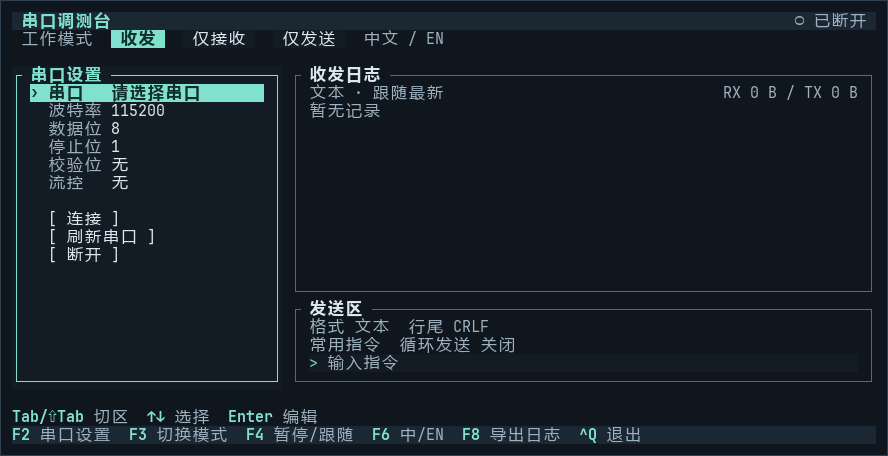

<h1 align="center">
  
</h1>

<p align="center">
  <strong>Linux 终端里的纯键盘串口调测台</strong><br>
  选串口、发文本或 HEX、看设备回包，一屏完成。
</p>

<p align="center">
  <kbd>🐧 Linux · x86_64 / ARM64 / ARMv7</kbd> &nbsp; <kbd>⌨️ 纯键盘</kbd> &nbsp; <kbd>🌐 中文 / English</kbd> &nbsp; <a href="LICENSE"><kbd>MIT</kbd></a>
</p>

<p align="center">
  <a href="#快速开始">⬇️ 快速开始</a> · <a href="#连接设备">🔌 连接设备</a> · <a href="#快捷键">⌨️ 快捷键</a> · <a href="README.md">English</a>
</p>

## 终端实录



画面录自 Linux 发布版，演示连接设备前的串口设置和模式切换。

## 快速开始

在要运行程序的 Linux 机器上执行 `uname -m`，按输出选择可执行文件。

| `uname -m` | 下载 |
| --- | --- |
| `x86_64` | [Linux x86_64](https://github.com/Boscodoggggg/serial-tui/releases/latest/download/serial-tui-linux-x86_64) |
| `aarch64` | [Linux ARM64](https://github.com/Boscodoggggg/serial-tui/releases/latest/download/serial-tui-linux-aarch64) |
| `armv7l` 或 `armv8l` | [Linux ARMv7（32 位，硬浮点）](https://github.com/Boscodoggggg/serial-tui/releases/latest/download/serial-tui-linux-armv7) |

ARM64 板卡可以直接运行下面的命令。其他架构请换成表中对应的下载地址。

```sh
curl -fL https://github.com/Boscodoggggg/serial-tui/releases/latest/download/serial-tui-linux-aarch64 -o serial-tui
chmod +x ./serial-tui
./serial-tui --lang zh
```

按 `F6` 切换中英文，按 `Ctrl+Q` 退出。

## 连接设备

```sh
./serial-tui --port /dev/ttyUSB0 --baud 115200 --lang zh
```

1. 插上串口适配器，把上面的设备路径和波特率换成实际值。按 `F2` 进入设置，用方向键和 `Enter` 可以调整串口、波特率、数据位、停止位、校验位和流控。
2. 选择「连接」打开串口。修改已连接设备的参数后，选「应用 / 重连」。设备未出现在列表里时，可选择「输入设备路径」。
3. 按 `F3` 选择收发模式。需要发送时，用 `Tab` 切到发送框，输入内容后按 `Enter`。

在插着串口设备的 Linux 机器上运行程序。遇到权限错误时，可用 `ls -l /dev/ttyUSB0` 查看设备节点，并使用有访问权限的账号运行。建议使用至少 80 列 × 24 行的终端。

| 模式 | 行为 |
| --- | --- |
| **收发** | 在同一份日志里看发送内容和设备回包。 |
| **仅接收** | 查看设备输出，发送区收起，循环发送停止。 |
| **仅发送** | 单次或循环发送指令，收到的字节会被丢弃。 |

## 快捷键

| 按键 | 操作 |
| --- | --- |
| `F2` / `F3` | 进入串口设置 / 切换收发模式 |
| `F4` / `F6` | 暂停或恢复跟随 / 切换中英文 |
| `F8` | 导出当前保留的日志到新文件，收发内容以 HEX 保存 |
| `Tab` / `Shift+Tab` | 在串口设置、日志、发送选项和发送框之间切换 |
| 日志区的 `PgUp` / `PgDn` · `←` / `→` · `End` | 翻页、横向查看长行、回到最新日志 |
| 日志区的 `H` | 切换文本、HEX、HEX + ASCII 显示 |
| 发送选项区的 `←` / `→` 和 `Enter` | 设置文本或 HEX、行尾、常用指令和循环间隔 |
| 发送框的 `↑` / `↓` · `Enter` · `Ctrl+U` | 调用历史、发送、清空输入 |
| `Esc` / `Ctrl+Q` | 关闭当前弹窗 / 退出程序 |

暂停时只冻结日志画面，串口仍继续接收。内存中保留最近 2,000 条记录。循环发送时，在循环选项上再按一次 `Enter` 就能停止。

## 许可证

[MIT](LICENSE)
